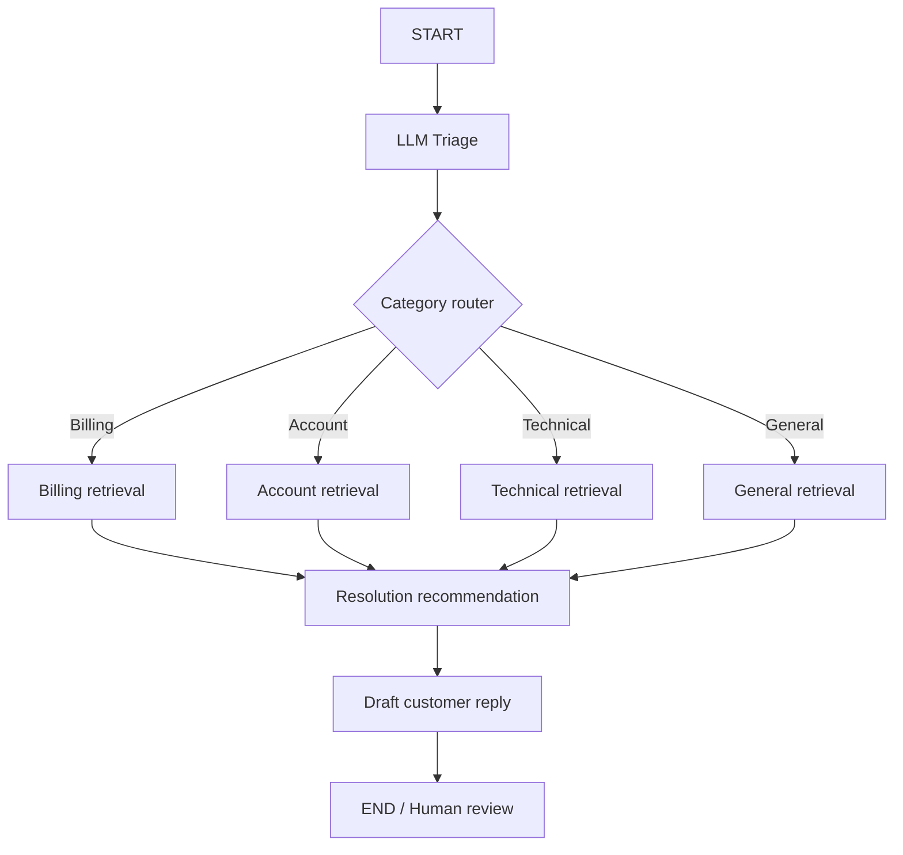

# Milestone 2 — LangGraph Agentic Support Workflow

## Overview

SupportPilot now exposes an agentic ticket workflow powered by LangGraph. The workflow runs ticket triage, uses conditional routing to select a retrieval path, retrieves knowledge from Qdrant, recommends a resolution, and drafts a customer-facing reply.

**Human approval is required:** the workflow never sends an email. The result is returned to the ticket drawer as an editable draft. An agent reviews/edits it and uses the existing Send Email action.

## Graph

## Shared state

The `SupportWorkflowState` TypedDict is passed between nodes. It includes ticket details, classification, routing, retrieved documents, recommendation, draft, status, and error information.

## Nodes

- `triage_ticket`: LLM classifies category, priority, sentiment, summary, and intent. Validated values are constrained to allowed enums. A deterministic heuristic is used when the model is unavailable or returns malformed JSON.
- `route_ticket`: chooses a retrieval branch from the normalized category.
- `retrieve_*`: uses the existing Qdrant service with a route-aware query.
- `recommend_resolution`: uses ticket details and retrieved passages to recommend next steps while identifying uncertainty.
- `draft_customer_reply`: produces an editable reply and avoids claims of completed actions or unsupported promises.

## API

`POST /api/tickets/{ticket_id}/workflow`

Runs the graph and returns:

- triage results and routing category
- retrieval count and citations
- resolution recommendation
- editable reply draft
- provider/demo modes
- updated ticket classification fields

The endpoint intentionally does not send an email. Sending is a separate human action using the existing reply endpoint.

## Frontend

The ticket drawer has **Run agentic workflow**. When complete, it displays the graph's major steps, triage results, retrieval information, recommendation, and populates the existing reply editor with the draft. The agent can edit, then send through the established email flow.

## Current limitations / next improvements

- Workflow execution currently runs in a single request; add checkpoint persistence and interrupt/resume for durable approval in a later iteration.
- Retrieval uses a category-enhanced query but does not yet evaluate retrieval quality or loop for a second search.
- Add workflow trace/metrics, structured tool events, evaluation cases, and stronger authorization before production deployment.
