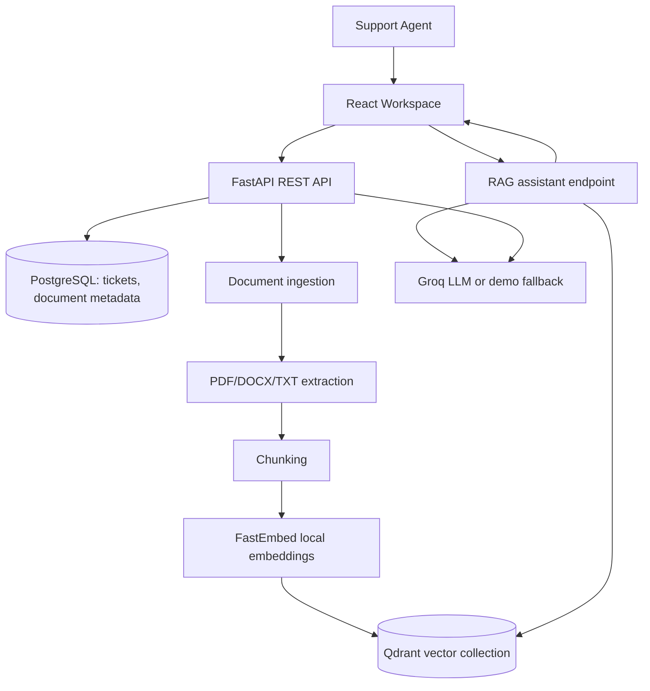

# Architecture

## Request flow

1. The browser calls FastAPI endpoints.
2. Ticket data is stored in PostgreSQL.
3. Uploaded knowledge files are extracted and chunked, embedded locally, and indexed in Qdrant.
4. RAG chat embeds a question, retrieves top relevant chunks, and sends only those chunks to the configured LLM.
5. The answer includes source names and page metadata. The UI treats AI outputs as suggestions; users must review them.

## Production hardening backlog

- Authentication, RBAC, tenant isolation
- Signed upload URLs and malware scanning
- Durable background queue for ingestion
- Secrets manager and key rotation
- PII redaction and retention policy
- Audit events for AI suggestions and ticket actions
- Observability: metrics, tracing, structured logs
- PostgreSQL migrations and backup/restore testing
- RAG evaluation dataset, prompt-injection defenses, quality gates
- Rate limiting, quotas, and abuse monitoring
- CI/CD, dependency scanning, container image signing
